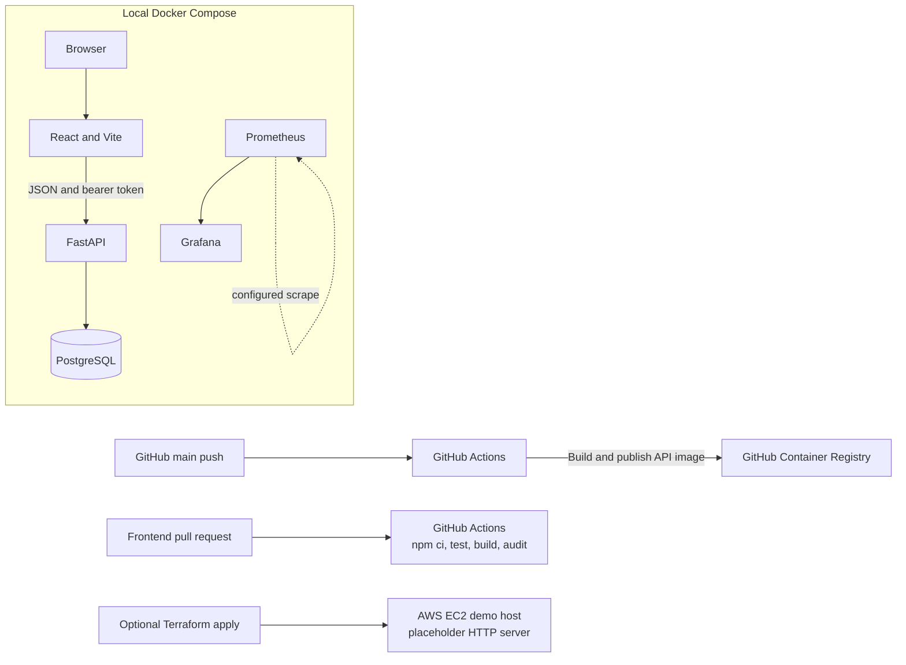

# CloudOps Deployment Lab

[](https://github.com/MohanaSrinivas/cloudops-deployment-lab/actions/workflows/build-publish.yml) [](https://github.com/MohanaSrinivas/cloudops-deployment-lab/actions/workflows/frontend-pr.yml)

A local-first lab for packaging and observing the ApplyTrack demo application. It combines Docker Compose, a GitHub Actions image build, a small Terraform EC2 example, and a local Prometheus/Grafana pair. The local workflow needs no AWS account or cloud resources.

## What this repository demonstrates

- Start the React frontend, FastAPI backend, and PostgreSQL together with Compose.
- Check the API health endpoint and inspect service logs.
- Run CI that tests the frontend on pull requests and builds/publishes the backend image from `main` to GHCR.
- Start Prometheus and Grafana locally; the supplied Prometheus configuration currently scrapes Prometheus itself. ApplyTrack does not expose application metrics, so the sample dashboard is not evidence of app performance.
- Inspect an optional, minimal AWS EC2/security-group configuration in Terraform. It starts a placeholder Python HTTP server, not ApplyTrack.

## Architecture



The local stack, CI publishing path, and optional Terraform exercise are separate. Terraform is not required by Compose or CI. CI publishes only the backend image, with a lowercase owner namespace and a mutable `latest` tag.

## Run locally

Requirements: Docker Desktop or Docker Engine with the Compose v2 plugin.

```bash
cp .env.example .env
```

For Windows PowerShell, use `Copy-Item .env.example .env`. Change the example `POSTGRES_PASSWORD`, `JWT_SECRET`, and `GRAFANA_ADMIN_PASSWORD` values for your local environment.

```bash
docker compose config --quiet
docker compose up --build
```

Open ApplyTrack at [http://localhost:5173](http://localhost:5173), API docs at [http://localhost:8000/docs](http://localhost:8000/docs), Prometheus at [http://localhost:9090](http://localhost:9090), and Grafana at [http://localhost:3000](http://localhost:3000). Grafana uses the `admin` username and `GRAFANA_ADMIN_PASSWORD` value (default: `admin-change-me`).

Stop services with `docker compose down`. Add `-v` only when you intentionally want to delete the local PostgreSQL and Grafana data volumes.

The optional `scripts/validate-local.sh` smoke script starts the Compose stack and then runs `docker compose down -v`, which deletes those volumes. Use it only when removing local stack data is acceptable. It requires Bash, Docker Compose, and curl.

## Run the application checks

Backend, from the repository root:

```bash
cd applytrack/backend
python -m pip install -r requirements.txt
ruff check app tests
```

Then run the tests with the package directory on Python’s import path:

```bash
# macOS/Linux/Git Bash
PYTHONPATH=. pytest -q
# Windows PowerShell
$env:PYTHONPATH = "."; python -m pytest -q
```

Frontend, from the repository root:

```bash
cd applytrack/frontend
npm ci
npm test
npm run build
npm audit
```

The frontend PR workflow runs those four frontend commands. This repository’s workflows do not run the nested backend tests; they can be run locally with the commands above. The separate ApplyTrack repository runs its backend tests and Ruff checks in CI.

## Optional AWS Terraform example

The Terraform directory creates an EC2 instance and a security group in the account’s default VPC. The security group permits inbound HTTP from `0.0.0.0/0`; instance startup runs a placeholder Python HTTP server. This is an infrastructure exercise, not a deployment of ApplyTrack, and is not suitable for public production use.

No AWS resources are required for local development. AWS resources can incur charges, including compute, storage, public IPv4, and data transfer. Review current AWS pricing and the Terraform plan before applying anything. These commands are provided for reviewers who deliberately choose to explore the example:

```bash
cd terraform
terraform init
terraform plan
# Only if you accept the plan and any charges:
terraform apply
terraform destroy
```

## Operational notes and limitations

- The API has a `/health` endpoint and Docker health check; it does not export Prometheus metrics.
- The dashboard is a starter configuration. It does not report measured application latency, throughput, or availability.
- The API image is published on pushes to `main` that touch `applytrack/**` or the publishing workflow, and on manual workflow dispatch. The `latest` tag is mutable; the frontend image is not published.
- Compose uses the Vite development server for the frontend.
- The Terraform example has no TLS, load balancer, managed database, private subnets, remote state, or least-privilege IAM design.

## Repository map

- `applytrack/` — application source, its own README, and API/frontend tests.
- `monitoring/` — Prometheus and Grafana provisioning files.
- `terraform/` — optional EC2 demonstration.
- `scripts/` — local smoke and Terraform validation helpers.
- `.github/workflows/` — container publishing and frontend pull-request validation.
