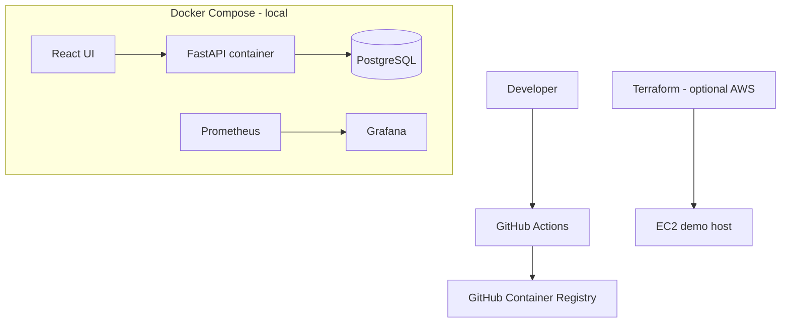

# CloudOps Deployment Lab

A local-first deployment and observability lab that packages the ApplyTrack application and demonstrates container builds, CI image publishing, Terraform infrastructure, health checks and monitoring.

## Problem
A service is not finished when it works on a laptop. This repository demonstrates repeatable packaging, environment configuration, deployment automation and basic operational visibility.

## Architecture


## Tech stack
Docker multi-stage build, Docker Compose, GitHub Actions, GitHub Container Registry, Terraform, AWS EC2, Prometheus and Grafana. The `applytrack/` directory contains the application workload.

## Run fully locally (no cloud account or paid resources)
1. Install Docker Engine/Desktop with Compose v2 and Git.
2. Copy `.env.example` to `.env`; change all example passwords.
3. Run `docker compose config` to validate configuration.
4. Run `docker compose up --build`.
5. ApplyTrack: http://localhost:5173; API docs: http://localhost:8000/docs; Prometheus: http://localhost:9090; Grafana: http://localhost:3000 (user `admin`, password from `GRAFANA_ADMIN_PASSWORD`).
6. Stop with `docker compose down`. Add `-v` only when you intentionally want to delete local database and Grafana data.

## CI image publishing
On pushes to `main` affecting `applytrack/`, GitHub Actions builds the API image and pushes it to `ghcr.io/<owner>/applytrack-api:latest`. GitHub's `GITHUB_TOKEN` is used; no long-lived registry password is stored. The workflow currently publishes the API image only. Extend it for the frontend and immutable SHA tags before production use.

## Optional AWS Terraform deployment and costs
Terraform in `terraform/` provisions a small EC2 instance and security group in the default VPC. It is deliberately separate from the local workflow.
```bash
cd terraform
terraform init
terraform plan
terraform apply
terraform destroy
```
**Cost warning:** AWS resources are not guaranteed free. EC2 compute, EBS storage, public IPv4 addresses and data transfer can incur charges, and free-tier eligibility varies by account, region and date. Do not run `apply` unless you understand the current AWS pricing. `terraform destroy` when finished. No AWS resource is required for local development.

## Health, logging and monitoring
- API container has a Docker health check against `/health`.
- Compose waits for PostgreSQL health before starting the API.
- Containers emit application/server logs to stdout/stderr; inspect with `docker compose logs -f api`.
- Prometheus and Grafana are provisioned locally. ApplyTrack currently exposes a health endpoint, not a Prometheus metrics endpoint; the dashboard is a starter example and meaningful application metrics require adding instrumentation/exporter. Do not interpret the starter dashboard as measured service performance.

## Tests and validation
```bash
docker compose config --quiet
bash scripts/validate-local.sh
```
The smoke test starts the stack, waits for the API health endpoint and tears down containers and volumes. It requires Docker and curl. The API's pytest suite is in `applytrack/backend`.

## Decisions and limitations
- The AWS example is a minimal infrastructure exercise, not a production architecture. It uses a public HTTP ingress rule and a placeholder HTTP server user-data command; do not expose sensitive data or use it as a production deployment.
- The Terraform example does not provision TLS, a load balancer, managed database, autoscaling, private subnets, IAM least-privilege policies or remote state.
- Local frontend uses Vite dev server for convenience, not a production static asset server.
- CI publishes only the API image and uses a mutable `latest` tag.
- Monitoring stack is functional as a local Prometheus/Grafana pair, but application-specific metrics instrumentation remains future work.

## What I would improve
- Add OpenTelemetry metrics/traces and a FastAPI Prometheus exporter with useful SLI dashboards.
- Build and publish the frontend image, use immutable tags and scan images for vulnerabilities.
- Replace EC2 demo with private networking, ALB + TLS, managed database, IAM roles and remote Terraform state with locking.
- Add deployment environments, approval gates, rollback and SBOM/provenance attestations.
- Add resource budgets and cost alerts before any cloud deployment.
